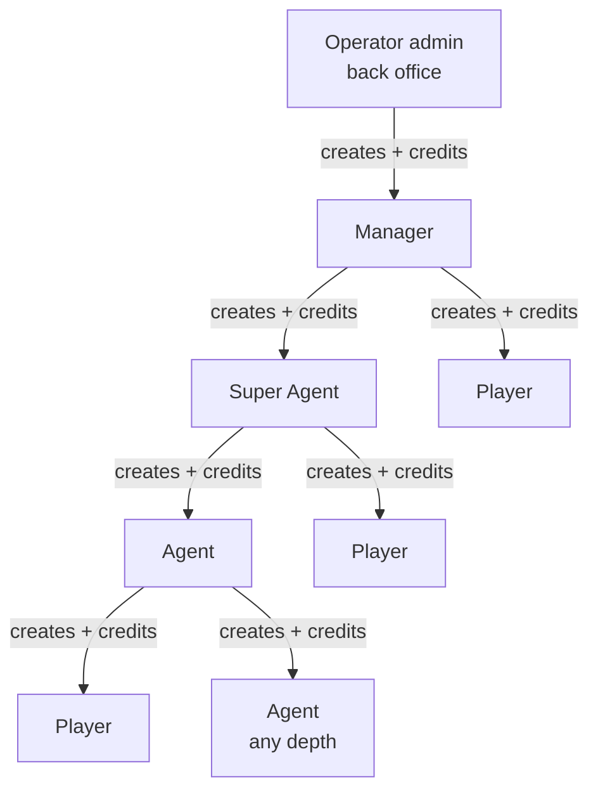
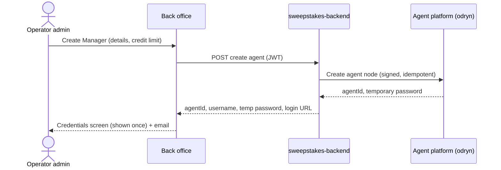
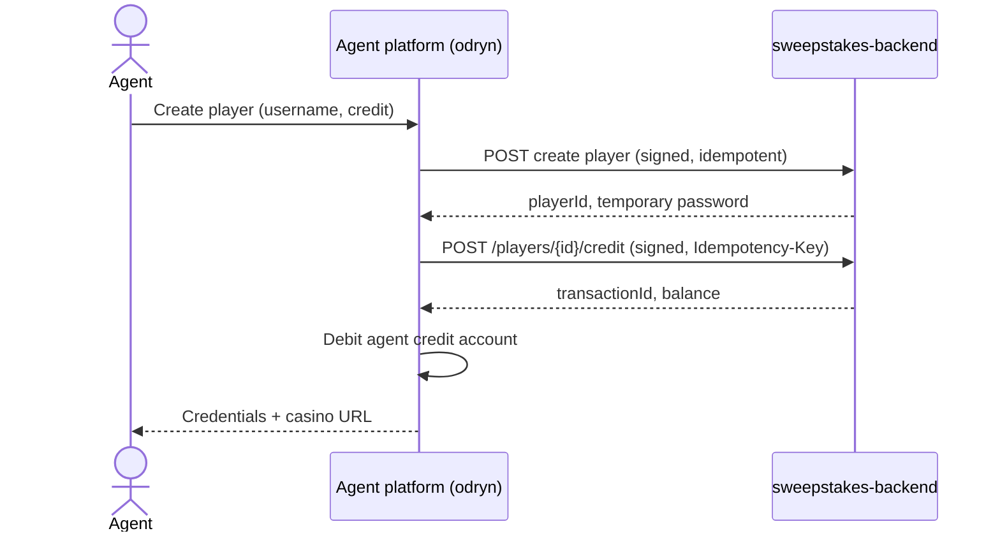

# Agent Network: Onboarding and Credit Flow

**Status:** draft for team review, 28 Oct 2026
**Related:** `plan.md` (architecture), `questions-and-answers.md` (decisions log), `../contract/openapi.yaml` (API contract)

This document describes the flow we agreed: how the operator admin starts an agent tree, how credit moves down it, how players are created, and how every new account gets its login.

---

## 1. The flow in one paragraph

The **operator admin** works in the existing back office. There they create a top-level agent, the **Manager**, by entering the Manager's details. The operator admin gives the Manager a **credit balance**. The Manager logs into the separate **agent platform**. From there the Manager can do two things:
- create agents below them (Super Agents, Agents), passing part of their credit down to each one, who can do the same further down;
- create **players** directly and credit them.

Every new account (Manager, Super Agent, Agent or player) receives a **username, a temporary password and a login URL**. On first login they must set a new password, then they use their console:
- Agents use the agent panel to manage their own agents and players.
- Players use the normal casino site to play.

## 2. Who is who

| Role | Created by | Logs in at | Can do |
|---|---|---|---|
| **Operator admin** | Already exists (back office) | Back office `<subdomain>.<ROOT_DOMAIN_BACK_OFFICE>` | Create Managers, give and take back their credit, freeze them, see all agent-linked players, open any agent panel by SSO |
| **Manager** (top-level agent) | Operator admin | Agent platform (odryn) | Create agents and players below them, move credit to them and back, freeze them, see their whole subtree |
| **Super Agent / Agent** | The agent directly above | Agent platform (odryn) | Same as the Manager, but only for their own subtree and only within their own credit |
| **Player** | Any agent (or the Manager) | Casino site `<subdomain>.<ROOT_DOMAIN>` | Play with the credit their agent gave them. No deposit, withdraw or bonuses. |

"Manager", "Super Agent" and "Agent" are **display labels only**. Nesting is unlimited, and every agent node behaves the same way (decision A1).

## 3. Step by step

### 3.1 Operator admin creates a Manager

1. In the back office, the operator admin opens **Agents → Create Manager**. They enter:
   - name
   - username
   - email and/or phone
   - the starting **credit limit**
   - along with all the details which are needed to create a agent in new platform
2. The back office calls our backend (`sweepstakes-backend`).
3. Our backend calls the agent platform to create the agent node (root = this operator). The agent platform:
   - stores the agent
   - generates a **temporary password**
   - returns the agent's id
4. Our backend stores the agent id for this operator, so the back office can list and manage it.
5. The operator admin sees the **credentials screen** once: username, temporary password and the agent platform login URL. If an email was given, the same details are also emailed.
6. The Manager's credit account is opened with the amount the operator admin chose.

### 3.2 Operator admin gives the Manager credit

- The operator admin sets or changes the Manager's credit from the back office. It is **always a limited amount** that the operator admin decides (decision B6).
- The agent platform records every change in **its own ledger**. No player wallet changes at this step: credit is the agent's budget, not money in any wallet.
- The operator admin can also take credit back, but only credit the Manager still has available, i.e. not passed down.

### 3.3 Manager (or any agent) creates agents below

1. In the agent panel, the agent opens **Create agent** and enters:
   - name
   - username
   - contact
   - the credit to give
2. The agent platform checks that the credit fits in the creator's **available credit**.
3. The new agent is created under the creator, and the credit moves from the creator's account to the new agent's.
4. The creator sees the credentials screen (username, temporary password, agent platform URL) to hand over.
5. The new agent can repeat this to any depth.

This step happens entirely inside the agent platform; our backend is not involved.

### 3.4 Any agent creates a player and credits them

1. In the agent panel, the agent opens **Create player** and enters:
   - username
   - contact (optional)
   - the starting credit
2. The agent platform calls **our backend** to create the player. We:
   - create a normal player user for that operator
   - mark them as linked to this agent (`agentId`)
   - block the paths agents' players must not use (B12): GlobalPayPro deposit, crypto withdrawal, welcome/referral/promo bonuses, wagering locks, KYC trigger, RG limits
   - generate the temporary password
3. If a starting credit was given, the agent platform calls our **credit** endpoint:
   - The amount goes to the player's **CASH** bucket with no wagering lock.
   - It is written to our normal transaction ledger with an idempotency key.
4. Only after our success, the agent platform deducts the same amount from the agent's credit account.
5. The agent sees the credentials screen: username, temporary password and the **casino site URL**.
6. The player appears in the operator admin's player list with an **Agent player** badge and filter (B5).

### 3.5 First login and password reset (everyone)

1. The new user opens the URL they were given:
   - **agents:** the agent platform
   - **players:** the operator's casino site
2. They log in with the username and temporary password.
3. They are forced to **set a new password** before anything else.
4. After that they reach their console:
   - **Agents:** the panel shows their subtree, with credit moves, corrections, freeze, bets and week totals.
   - **Players:** the casino lobby, with deposit and withdraw hidden.
5. A forgotten password is reset by the person directly above them (agent or operator admin), who issues a new temporary password. The same forced change applies on the next login.

### 3.6 Ongoing credit moves

| Action | Done by | Effect |
|---|---|---|
| Give credit to an agent below | Any agent | Moves credit down, inside the agent platform only |
| Take credit back from an agent below | Any agent | Only the part the agent below has not passed further down |
| Credit a player | The player's agent | Our `credit` endpoint adds to the player's CASH; then the agent's credit goes down |
| Withdraw from a player | The player's agent | Our `withdraw` endpoint (up to the player's balance); then the agent's credit goes back up |
| Freeze / unfreeze | Anyone above | Agent: blocks their login and actions. Player: our `freeze` endpoint blocks login and bets. |

**Credit rule:** an agent can never give out more than their own available credit. The total of what is handed down a branch never exceeds what the operator admin gave the Manager at the top.

### 3.7 Weekly close (summary)

Every Tuesday 11:00 in the operator's time zone:
1. The week is snapshotted.
2. Player balances added by agents are reset to 0.
3. Agents settle offline with the agent above.

The full rules (continue vs pause, snapshot, reset) are in `plan.md` section 9.

## 4. Who stores what

| sweepstakes-backend (ours) | Agent platform |
|---|---|
| Player accounts, passwords, wallets, transaction ledger | Agent accounts and passwords, the agent tree |
| `users.agentId` and the agent-player mapping | Agent credit accounts and the ledger of every credit move |
| The operator → Manager link (for the back office screens) | Week snapshots, shares, commissions, discounts |
| Player activity pushed to odryn (bets, wins, refunds) | Totals rolled up the tree from that activity |

## 5. What the API contract needs for this flow

`contract/openapi.yaml` (v0.1.0) already covers player credit, withdraw, freeze, activity events and the weekly close. This flow also needs:

| Missing call | Direction | Purpose |
|---|---|---|
| Create agent / Manager | ours → odryn | Step 3.1: the operator admin creates a Manager from the back office |
| Set / change a Manager's credit | ours → odryn | Step 3.2 |
| Freeze a Manager, reset their password | ours → odryn | Operator admin controls over the top level |
| SSO link to an agent panel | ours → odryn | The operator admin opens a Manager's panel |
| Create player | odryn → ours | Step 3.4: returns `playerId` and a temporary password |
| Reset a player's password | odryn → ours | Step 3.5, a forgotten password |

## 6. Changes this implies on our side

- **Back office:**
  - an **Agents** area: list, create Manager, set credit, freeze, reset password, open panel by SSO
  - the credentials screen
  - an Agent player badge and filter in the player list
- **sweepstakes-backend:**
  - the `agent` module (see `plan.md` section 6)
  - the inbound **create player** endpoint
- **Player login:** today players register themselves with email and OTP. Agent players need:
  - **username + password** login
  - a **forced password change on first login**
  - no self-registration through the agent flow
- **Player site:** hide deposit, withdraw and bonus entry points for agent players.

## 7. Open questions

| # | Question | Assumed answer |
|---|---|---|
| F1 | How are credentials delivered: shown once on screen, emailed, or both? | Shown once to the creator, plus email when an address is given |
| F2 | Do agents need an email or phone, or is a username enough? | Username required, contact optional |
| F3 | Do players need an email or phone? | Optional; the agent hands the login over in person |
| F5 | Who resets a forgotten password? | The account directly above |
| F7 | Credit limit: set per agent, per level, or one limit for the whole tree? (open item D6) | Per agent, set by the parent |
| F8 | Is the operator admin's own pool limited, or only what they give each Manager? | Only per Manager (B6) |
